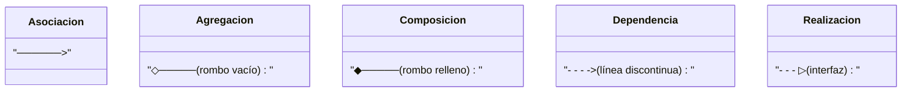

# 🎓 Actividad 3: Programación Orientada a Objetos en Java

Proyecto académico completo en **Java** para **Apache NetBeans** que cubre los 11 temas de la Actividad Tres de POO.

---

## 📋 Temas Implementados

| # | Tema | Archivo Principal |
|---|------|------------------|
| 1 | Sobrecarga y Sobreescritura de Métodos | `tema01_sobrecarga_sobreescritura/` |
| 2 | Asociación entre Clases | `tema02_asociacion/` |
| 3 | Asociación de Agregación | `tema03_agregacion/` |
| 4 | Asociación de Composición | `tema04_composicion/` |
| 5 | Asociación de Dependencias | `tema05_dependencia/` |
| 6 | Asociación de Realización (Interfaces) | `tema06_realizacion/` |
| 7 | Polimorfismo | `tema07_polimorfismo/` |
| 8 | Cardinalidad en Clases (1..*, *..*) | `tema08_cardinalidad/` |
| 9 | Clase Stream y Operaciones Funcionales | `tema09_streams/` |
| 10 | Colecciones ArrayList y Map | `tema10_colecciones/` |
| 11 | Hilos en Java (Multithreading) | `tema11_hilos/` |

---

## 🏛️ Diagrama de Relaciones UML



| Relación | Símbolo | Acoplamiento | Ciclo de Vida | Java |
|:---------|:-------:|:------------:|:-------------:|:----:|
| Asociación | `──────>` | Débil | Independiente | Atributo de referencia |
| Agregación | `◇─────` | Moderado | Independiente | Colección / Parámetro |
| Composición | `◆─────` | Fuerte | Dependiente | `new` en constructor |
| Dependencia | `- - ->` | Efímero | Transitorio | Parámetro de método |
| Realización | `- - ▷` | Contractual | Interfaz | `implements` |

---

## 📂 Estructura del Proyecto

```
Actividad3POO/
├── pom.xml                                    <- Maven para Apache NetBeans
├── .gitignore
├── README.md
├── docs/
│   └── investigacion_actividad_3.md           <- Teoría, UML y código comentado
└── src/main/java/com/poo/actividad3/
    ├── app/
    │   └── Main.java                          <- Menú interactivo (opciones 1-13)
    ├── tema01_sobrecarga_sobreescritura/
    ├── tema02_asociacion/
    ├── tema03_agregacion/
    ├── tema04_composicion/
    ├── tema05_dependencia/
    ├── tema06_realizacion/
    ├── tema07_polimorfismo/
    ├── tema08_cardinalidad/
    ├── tema09_streams/
    ├── tema10_colecciones/
    └── tema11_hilos/
```

---

## 🚀 Cómo abrir y ejecutar en Apache NetBeans

1. Abre **Apache NetBeans**.
2. Ve a **File > Open Project...** (`Ctrl + Shift + O`).
3. Selecciona la carpeta `Actividad3POO`.
4. Presiona **F6** o el botón ▶ **Run Project**.
5. En la consola inferior, ingresa:
   - **Opciones 1-11** → Demostración individual de cada tema.
   - **Opción 12** → Demostración completa de todos los temas en secuencia *(recomendado para el video)*.
   - **Opción 13** → Salir.
