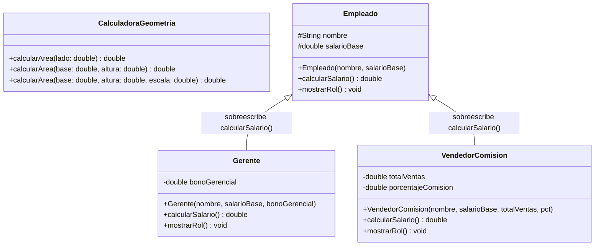
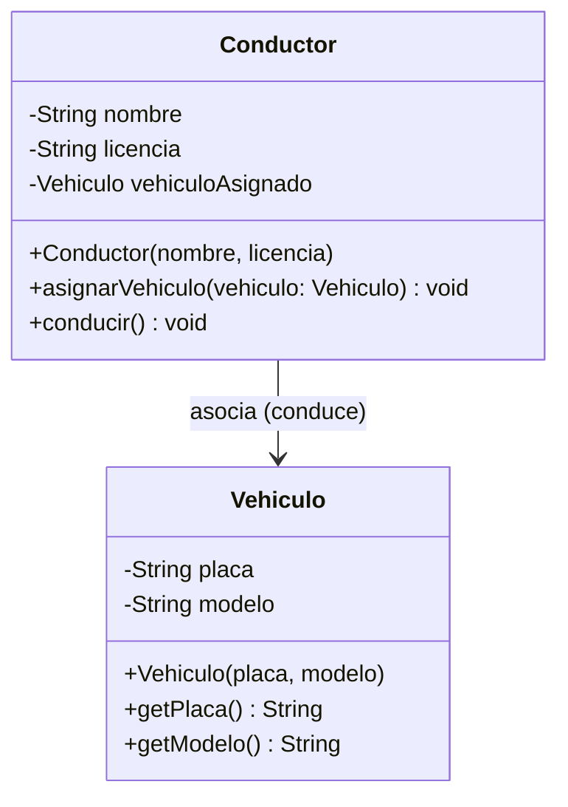
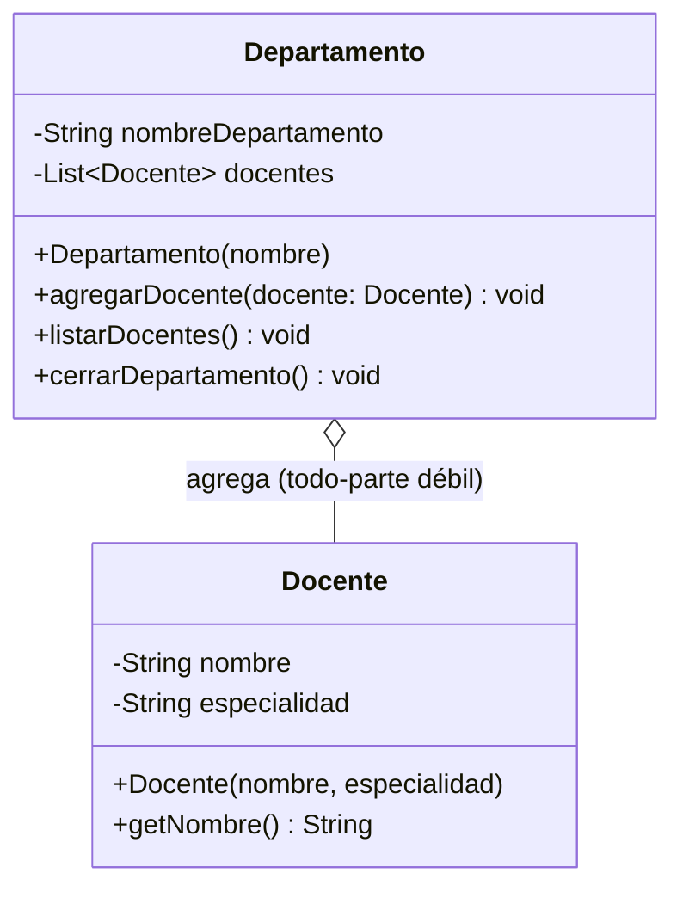
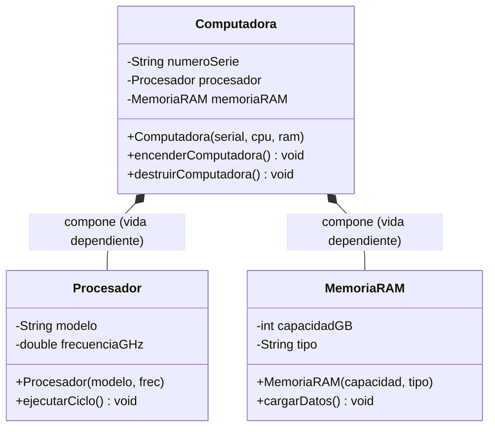
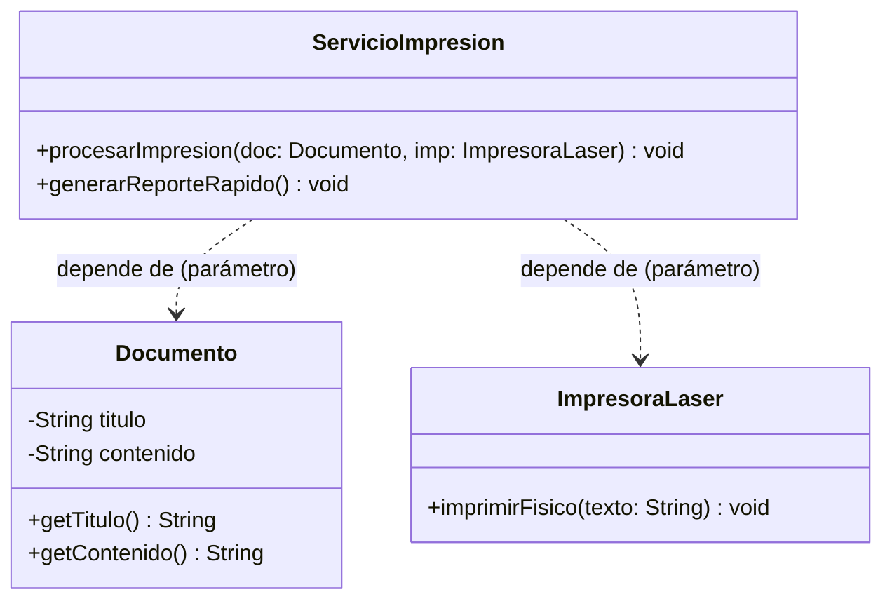
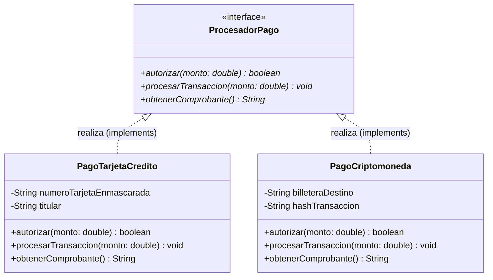
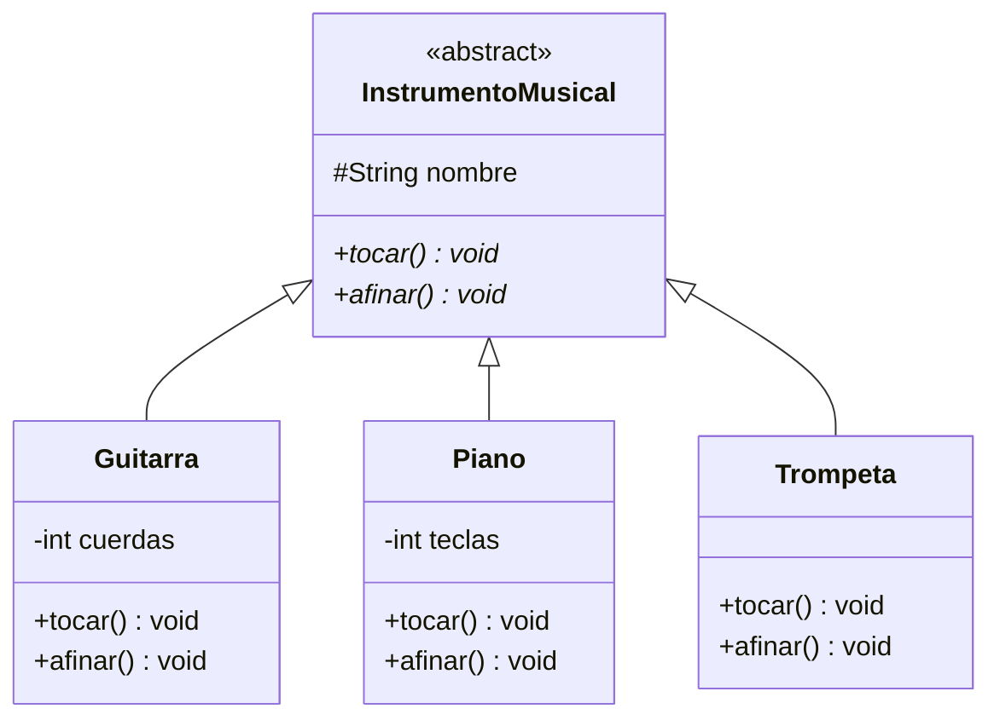
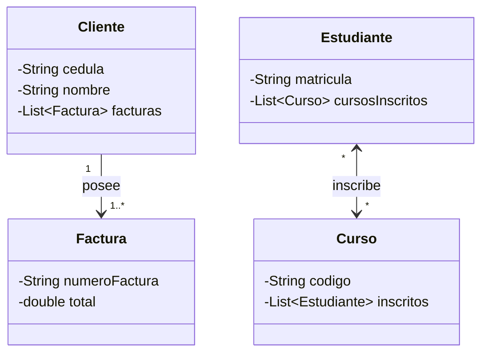

# Investigación Completa y Guía Técnica: Actividad Tres (POO)

**Asignatura:** Programación Orientada a Objetos (POO)  
**Entorno de desarrollo:** Apache NetBeans / Java SE 17+  
**Objetivo:** Sustentación teórica, análisis de diagramas de clases UML y demostración práctica en código Java para video de YouTube.

---

## 📑 Tabla de Contenidos
1. [Tema 1: Sobrecarga y Sobreescritura de Métodos](#1-sobrecarga-y-sobreescritura-de-métodos)
2. [Tema 2: Asociación entre Clases](#2-asociación-entre-clases)
3. [Tema 3: Asociación de Agregación en Clases](#3-asociación-de-agregación-en-clases)
4. [Tema 4: Asociación de Composición en Clases](#4-asociación-de-composición-en-clases)
5. [Tema 5: Asociación de Dependencias](#5-asociación-de-dependencias)
6. [Tema 6: Asociación de Realización (Interfaces)](#6-asociación-de-realización-interfaces)
7. [Tema 7: Polimorfismo en POO](#7-polimorfismo-en-poo)
8. [Tema 8: Cardinalidad (Multiplicidad) en Clases](#8-cardinalidad-multiplicidad-en-clases)
9. [Tema 9: La Clase Stream y Operaciones Funcionales](#9-la-clase-stream-y-operaciones-funcionales)
10. [Tema 10: Colecciones ArrayList y Map en Java](#10-colecciones-arraylist-y-map-en-java)
11. [Tema 11: Hilos (Multithreading) en Java](#11-hilos-multithreading-en-java)
12. [Tabla Comparativa de Relaciones UML](#12-tabla-comparativa-de-relaciones-uml)

---

## 1. Sobrecarga y Sobreescritura de Métodos

### Fundamentación Teórica
| Criterio | Sobrecarga de Métodos (*Overloading*) | Sobreescritura de Métodos (*Overriding*) |
| :--- | :--- | :--- |
| **Definición** | Múltiples métodos con el **mismo nombre** pero **diferente lista de parámetros**. | Una subclase **redefine** el comportamiento de un método heredado de su superclase. |
| **Ámbito** | Ocurre en la **misma clase**. | Ocurre entre **dos clases en relación de herencia** (superclase y subclase). |
| **Firma del método** | **Debe cambiar** (número, tipo u orden de parámetros). | **Debe ser exactamente idéntica** (mismo nombre, mismos parámetros, mismo tipo de retorno). |
| **Anotación** | No utiliza anotaciones especiales. | Se documenta con `@Override` para validación en compilación. |
| **Tipo de Polimorfismo** | **Polimorfismo Estático** (en tiempo de compilación). | **Polimorfismo Dinámico** (en tiempo de ejecución / *dynamic dispatch*). |

### Diagrama de Clases UML


### Código Java Destacado
```java
// Sobrecarga: misma clase, diferente firma
public double calcularArea(double lado) { return lado * lado; }
public double calcularArea(double base, double altura) { return base * altura; }

// Sobreescritura: herencia y @Override
@Override
public double calcularSalario() {
    return salarioBase + bonoGerencial; // Nueva lógica en la subclase Gerente
}
```

---

## 2. Asociación entre Clases

### Fundamentación Teórica
* **Definición:** Es una relación estructural general donde una clase "conoce" a otra o interactúa con ella.
* **Propiedad y Ciclo de Vida:** **No existe dependencia de vida.** Los dos objetos se crean de forma independiente y, si la relación termina, ambos siguen existiendo en memoria.
* **Representación UML:** Una línea continua simple entre ambas clases (`Conductor ─── Vehiculo`). Puede tener una flecha de navegabilidad (unidireccional o bidireccional).
* **Implementación en Java:** Se declara un atributo de tipo de la otra clase (`private Vehiculo vehiculoAsignado`).

### Diagrama de Clases UML


---

## 3. Asociación de Agregación en Clases

### Fundamentación Teórica
* **Definición:** Es una relación "TODO - PARTE" de **acoplamiento débil**. El objeto contenedor representa el "todo" y contiene referencias a sus "partes".
* **Ciclo de Vida:** **Independiente.** Las partes pueden crearse antes del todo y pueden sobrevivir si el todo se destruye.
* **Analogía:** Un departamento universitario y sus profesores; si el departamento se disuelve, los profesores siguen perteneciendo a la universidad y pueden ser transferidos.
* **Representación UML:** Línea continua con un **rombo blanco o vacío** (`o--`) en el extremo del "todo".
* **Implementación en Java:** Los objetos parte se reciben por parámetro (en el constructor o mediante métodos `agregarParte()`), típicamente almacenados en una colección (`List<Docente>`).

### Diagrama de Clases UML


---

## 4. Asociación de Composición en Clases

### Fundamentación Teórica
* **Definición:** Es una relación "TODO - PARTE" de **acoplamiento fuerte**. El todo es propietario absoluto de sus partes.
* **Ciclo de Vida:** **Dependiente.** Las partes no tienen sentido de existencia fuera del todo. Nacen con el todo y mueren cuando el todo se destruye.
* **Analogía:** Una computadora y sus componentes físicos integrados (CPU y Memoria RAM).
* **Representación UML:** Línea continua con un **rombo negro o relleno** (`*--`) en el extremo del "todo".
* **Implementación en Java:** El objeto "todo" es el encargado de instanciar directamente a sus partes dentro de su propio constructor con `new`. Las partes no se comparten con el exterior.

### Diagrama de Clases UML


---

## 5. Asociación de Dependencias

### Fundamentación Teórica
* **Definición:** Es una relación transitoria ("USA UN" / *uses-a*). Ocurre cuando una clase depende temporalmente de otra para realizar una tarea específica, pero **no guarda una referencia a ella como atributo de instancia**.
* **Manifestaciones en código:**
  1. Un objeto se recibe como parámetro de un método: `public void procesar(Documento doc)`.
  2. Un objeto se instancia como variable local temporal dentro de un método y luego se descarta.
  3. Se invoca un método estático de otra clase.
* **Representación UML:** Línea discontinua con **flecha abierta** (`..>`) desde la clase cliente hacia la clase proveedora.

### Diagrama de Clases UML


---

## 6. Asociación de Realización (Interfaces)

### Fundamentación Teórica
* **Definición:** Es el vínculo contractual donde una **clase concreta** implementa las operaciones declaradas en una **interfaz** (especificación abstracta).
* **Principio:** La interfaz declara el **"QUÉ"** (la firma de los métodos), y la clase concreta proporciona el **"CÓMO"** (el código ejecutable).
* **Representación UML:** Línea discontinua con **triángulo cerrado y vacío** (`..|>`) apuntando hacia la interfaz.
* **Implementación en Java:** Palabra reservada `implements`.

### Diagrama de Clases UML


---

## 7. Polimorfismo en POO

### Fundamentación Teórica
* **Definición:** Propiedad que permite enviar el **mismo mensaje** a diferentes objetos y que cada uno responda de manera particular según su naturaleza concreta.
* **Enlace Dinámico (*Dynamic Dispatch*):** En tiempo de ejecución, la Máquina Virtual de Java (JVM) inspecciona el tipo real del objeto en memoria y ejecuta el método sobrescrito correspondiente.

### Diagrama de Clases UML


---

## 8. Cardinalidad (Multiplicidad) en Clases

### Fundamentación Teórica
* **Notaciones estándar UML:**
  * `1` o `1..1`: Exactamente uno.
  * `0..1`: Cero o uno (opcional).
  * `*` o `0..*`: Cero a muchos.
  * `1..*`: Uno a muchos (mínimo uno).
* **Mapeo a Java:**
  * Cardinalidades simples se traducen en **atributos de referencia directa**.
  * Cardinalidades múltiples se traducen en **Colecciones** (`List<T>`, `Set<T>`).

### Diagrama de Clases UML


---

## 9. La Clase Stream y Operaciones Funcionales

### Fundamentación Teórica
* **Operaciones Intermedias (*Lazy*):** `filter()`, `map()`, `sorted()`, `distinct()`, `limit()`.
* **Operaciones Terminales (*Eager*):** `collect()`, `forEach()`, `reduce()`, `count()`, `findFirst()`, `anyMatch()`.

---

## 10. Colecciones ArrayList y Map en Java

| Característica | `ArrayList<E>` | `Map<K, V>` (`HashMap<K, V>`) |
| :--- | :--- | :--- |
| **Organización** | Secuencia lineal basada en índices numéricos (`0..n-1`). | Pares asociativos Clave - Valor ($K \rightarrow V$). |
| **Duplicados** | Permite elementos duplicados. | Claves estrictamente únicas; valores repetibles. |
| **Búsqueda** | Por índice: $O(1)$. Por contenido: $O(n)$. | Inmediata por clave: $O(1)$ amortizado. |

---

## 11. Hilos (Multithreading) en Java

* **Creación:** Mediante `extends Thread` o `implements Runnable`.
* **Ciclo de vida:** `start()`, `run()`, `sleep()`, `join()`.
* **Sincronización:** `synchronized` previene condiciones de carrera garantizando atomicidad y consistencia en memoria compartida.

---

## 12. Tabla Comparativa de Relaciones UML

| Relación UML | Símbolo Visual UML | Tipo de Acoplamiento | Ciclo de Vida | Palabra clave en Java |
| :--- | :---: | :---: | :---: | :---: |
| **Asociación** | `──────>` | Débil | Independiente | Atributo de referencia |
| **Agregación** | `◇─────` (rombo vacío) | Moderado / Débil | Independiente | Colección / Parámetro |
| **Composición** | `◆─────` (rombo relleno) | Fuerte | Dependiente del todo | `new` dentro del constructor |
| **Dependencia** | `- - - - >` | Muy débil / Efímero | Transitorio | Parámetro de método o variable local |
| **Realización** | `- - - - ▷` | Estructural | Contrato de interfaz | `implements` |
| **Herencia** | `───────▷` | Fuerte | Jerarquía de tipos | `extends` |
